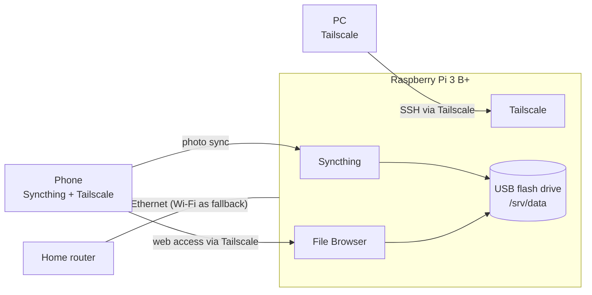

# Home Cloud Server on a Raspberry Pi 3 B+

> **Status: work in progress.** Setup, file-service, remote-access and network-path measurements are complete. Automated backups and a timed restore test are next, so this server is **not yet** the only copy of any data.

A self-hosted replacement for paid cloud storage. Phone photos sync automatically to a Raspberry Pi, files are available through a web page, and every device reaches the server from anywhere through a private Tailscale network, with no port forwarding and no open ports.

The project is built around measurement: every limit below was tested, not assumed, and every result notes the conditions it was measured under.

## Goals
- Replace paid cloud storage for photos and files.
- Reach the server from a phone and a PC, at home and away.
- Back up automatically and prove it with a timed restore test.
- Find the real bottleneck at each stage instead of guessing it.

## Hardware
| Part | Notes |
| --- | --- |
| Raspberry Pi 3 Model B+ | 1 GB RAM; gigabit Ethernet that shares one USB 2.0 link with the USB ports |
| 32 GB microSD | Operating system only |
| 128 GB USB flash drive | ext4, mounted at `/srv/data`; holds all synced data |
| 5 V micro-USB supply, 2.5 A or more | The 3 B+ undervolts on weaker chargers (see Troubleshooting 4) |
| Cat 6 Ethernet cable | Wired to the home router; the Pi's built-in Wi‑Fi is an automatic fallback |

## Software
| Component | Role |
| --- | --- |
| Raspberry Pi OS Lite 64-bit (Debian 13 "Trixie") | Headless OS, SSH key login |
| Syncthing | Phone camera folder → Pi. The phone is send-only and the Pi is receive-only, with trash-can versioning, so deleting a photo on the phone doesn't delete the backup |
| File Browser | Web interface for browsing, uploading and downloading files |
| Tailscale | Private WireGuard network linking the Pi, phone and PC; no ports opened on the router |

**Why not Nextcloud?** Nextcloud is a full Google Drive replacement, but it needs more memory than the Pi 3's 1 GB to run smoothly. Syncthing plus File Browser covers sync and web access with far less memory. Nextcloud or Immich become options on hardware with 4 GB or more.

## Architecture

## How things were measured
- **Disk:** `dd` with 512 MiB and direct I/O (`oflag=direct` / `iflag=direct`), so the Pi's memory cache doesn't inflate the result.
- **Network:** `iperf3`, 10 seconds, in both directions.
- **File Browser:** `curl` against its API, timing a 1 GiB random file and 500 random files of 200 KiB each (random data, so nothing can be compressed along the way).
- **Remote downloads:** the Pi's network counters sampled every 5 seconds, cross-checked against screen recordings of the phone's download progress.
- **Power:** `vcgencmd get_throttled` before and after each test. A result only counts if it read `0x0`, meaning no undervoltage or throttling during the test.

## Results

### 1. Baseline: Pi 3 B vs. Pi 3 B+
The project started on a Pi 3 Model B; its Ethernet capped every test at 94 Mbps, so the same SD card and drive were moved to a Pi 3 B+.

| Metric | Pi 3 B | Pi 3 B+ |
| --- | --- | --- |
| Ethernet link speed | 100 Mbps | 1000 Mbps |
| iperf3 PC → Pi | 94 Mbps | 307 Mbps |
| iperf3 Pi → PC | 94 Mbps | 277 Mbps |
| Flash drive write / read | 7.3 / 31.6 MB/s* | 20.2 / 32.9 MB/s |
| microSD write / read | 7.4 / 18.8 MB/s | 9.1 / 23.1 MB/s |

\* Measured right after 17 GB had been written to the drive. The two runs differ in more than the board, so the write difference isn't attributed to the board.

### 2. File service (Pi 3 B+, PC on a direct cable to the Pi)
| Test | Result |
| --- | --- |
| File Browser download, 1 GiB | 20.7 MB/s |
| File Browser download, 500 × 200 KiB | 9.6 MB/s, 46.8 files/s (~21 ms per file), 500/500 succeeded |
| File Browser upload, 1 GiB | 7.3 MB/s |
| Syncthing PC → Pi, one 1 GiB file | 7.1 MB/s, 0 errors |
| Syncthing PC → Pi, 500 × 200 KiB | 1.9 MB/s, 9.3 files/s, 0 errors |
| Drive write, 8 × 256 MiB back to back | 7.8–11.6 MB/s per piece, 9.7 MB/s overall |
| Same test after 30 min idle | 10.4, 16.8, **29.8, 30.1**, 8.9, 7.1, 11.2, 10.5 MB/s (12.1 MB/s overall) |
| File Browser login page (median of 5) | 3.8 ms |
| Folder listing, ~1,800 files (median of 5) | 221 ms (first, uncached listing: 2.85 s) |

**What it shows**
- **The USB flash drive's write speed is the bottleneck.** Sustained writes settle at 7–11 MB/s whether the data comes from `dd`, File Browser or Syncthing, far below what the network carries (~300 Mbps ≈ 37 MB/s).
- **The drive writes in bursts after resting.** After 30 minutes idle, two pieces reached ~30 MB/s before writes fell back. That fits a small fast write area that refills while idle. One run only, so the pattern isn't proven.
- **Downloads hit a shared limit.** A 1 GiB download (20.7 MB/s) is slower than the drive's reads (32.9 MB/s) or the network alone. On the Pi 3 B+ the drive and the Ethernet chip share one USB 2.0 connection, so they compete during a download (likely cause; not isolated).
- **Small files are expensive, most of all in Syncthing:** 9.3 files/s vs. 46.8 files/s for File Browser downloads. Each Syncthing file costs hashing, a temporary file, a rename and a database update on a slow CPU.
- **First phone sync:** a ~17 GB photo library finished with 0 errors in at most about 3 h 20 min. During it, the Pi spent 33–42% of its CPU time waiting on the flash drive.

### 3. Remote access over Tailscale
| Test | Result |
| --- | --- |
| Latency to phone on home Wi‑Fi (10 pings) | direct connection, median 28.5 ms (9–127 ms) |
| Latency to phone on mobile data (10 pings) | direct connection, median 76.5 ms (58–115 ms) |
| Home internet upload (speed test) | ~18 Mbps |
| One 100 MB download, phone on fast 5G | ~2.7 MB/s (≈22 Mbps); about 38 s |
| Two 100 MB downloads at once, fast 5G | ~2.4 MB/s combined |
| One 100 MB download, phone on 4G LTE | 0.15 MB/s for ~2.5 min, then ~0.8 MB/s |

**What it shows**
- **Away from home, the home internet upload is the ceiling.** On a strong 5G signal a single download ran at about the home upload speed, and two downloads at once just split it.
- **On a weak mobile signal, the phone's connection is the limit.**
- **A hypothesis that a single download connection is limited on its own was tested and ruled out.**
- **Method lesson:** the phone's browser starts downloading before its prompts are dismissed, so timing downloads from screen recordings overstated speeds. Remote speeds are now measured from the Pi's side.

### 4. Network path: through the PC vs. through the router
The Pi first got its internet through a PC that shared its Wi‑Fi over a direct cable. It now plugs into the home router. In the router setup the **PC is on Wi‑Fi**, so PC ↔ Pi results include the PC's Wi‑Fi link.

| Test | Through the PC (cable) | Through the router |
| --- | --- | --- |
| iperf3 PC → Pi | 307 Mbps | 328 Mbps |
| iperf3 Pi → PC | 277 Mbps | 283 Mbps |
| File Browser download, 1 GiB | 20.7 MB/s | 20.8 MB/s |
| File Browser download, 500 × 200 KiB | 9.6 MB/s (~21 ms per file) | 4.6 MB/s (~45 ms per file) |
| File Browser upload, 1 GiB | 7.3 MB/s | 5.0 MB/s |

**What it shows**
- **Large transfers didn't change:** the Pi's USB 2.0 limit, not the network path, sets the speed for big files.
- **Small files became twice as slow,** most likely because each request now crosses the PC's Wi‑Fi (not isolated).
- **The slower upload isn't attributed to the router:** it's a single run, and the flash drive's write speed varies from run to run.
- **Remote check:** Tailscale used a relay server for the first few pings, then switched to a direct connection (median 67.5 ms). A remote download test was inconclusive because the phone's mobile connection measured only 1.7 Mbps at the time.

## Troubleshooting log
| # | Symptom | Cause | Fix |
| --- | --- | --- | --- |
| 1 | Pi got no IP address over the PC's shared Ethernet | The PC's firewall (ufw) blocked DHCP and forwarding on that port | Allowed incoming and routed traffic on that port only |
| 2 | Link stuck at 94 Mbps on a new Cat 6 cable | `ethtool` showed the Pi 3 Model B only supports 10/100 Mbps | Moved the SD card and drive to a Pi 3 B+, which linked at 1000 Mbps |
| 3 | The PC's wired connection kept "deactivating" every few minutes | The sharing profile was set not to auto-connect, so NetworkManager kept trying a DHCP client profile that can't work on a direct cable | Re-enabled auto-connect, with a higher priority for the sharing profile |
| 4 | Undervoltage warnings on the 3 B+ (`get_throttled` = `0x50000`) | An unrated headset charger with a thin cable | Switched to a 5 V supply rated 2.5 A or more; `get_throttled` = `0x0` under load. Brief dips can still appear right after boot |
| 5 | Syncthing's command-line tool crashed when adding a device with two addresses | A bug in the CLI | Added the device through Syncthing's REST API |
| 6 | The phone's "add folder" form wouldn't save | Unknown | Created the folder on the Pi and offered it to the phone instead |
| 7 | A stress test showed `get_throttled` = `0x80000` | Soft temperature limit reached with all 4 cores at 100%; not a power problem | None needed for normal server load; a heatsink if it appears during syncs |

## Limitations
- The USB flash drive limits writes to roughly 7–11 MB/s and isn't built for constant server writes.
- Everything on the Pi 3 B+ shares one USB 2.0 link, so drive and network compete.
- Remote speed is capped by the home internet upload.
- Backups and a restore test aren't done yet.

## Roadmap
- [x] Setup and baseline measurements
- [x] File service measurements (File Browser and Syncthing)
- [x] Remote access measurements (home Wi‑Fi vs. mobile data)
- [x] Network path comparison (through a PC vs. the home router)
- [ ] Move the server to a spare laptop and repeat the same tests for a Pi vs. laptop comparison
- [ ] Automated second copy, timed restore test and a pull-the-power test
- [ ] Import an existing cloud photo library, remove duplicates, then a month of daily use before cancelling the paid plan
- [ ] Final results, limitations and upgrade decision

## Security notes
- No ports are open to the internet; remote access only works through Tailscale.
- SSH uses key login. Turning off password login is planned.
- Device IDs, network addresses and account details are deliberately left out of this repository.
